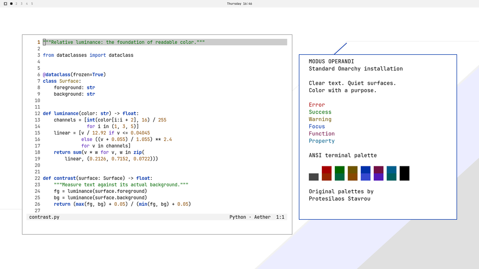

# Modus Operandi for Omarchy

The standard-install edition of Modus Operandi, based on [Modus Themes by Protesilaos Stavrou](https://protesilaos.com/emacs/modus-themes/).



## Install

In Omarchy, open **Install → Style → Theme** and paste this repository URL, or run:

```sh
omarchy theme install https://github.com/codingquark/omarchy-modus-operandi-theme
```

Select `modus-operandi` in the theme picker. Omarchy's theme updater can pull future updates from this repository.

If the full Modus package already owns a local `modus-operandi` theme symlink, choose which edition to keep before installing this one: both use the same theme name. The standard installer replaces an existing entry with that name.

## What this edition includes

The palette, wallpaper, shell, btop, Helix, browser tint and VS Code color files come from the [shared source package](https://github.com/codingquark/omarchy-modus-themes). Omarchy generates its standard terminal, Hyprland and Aether/Neovim configuration from `colors.toml`.

This edition does not include the full package's custom Modus Neovim highlight groups, exact terminal ANSI/cursor/opacity settings, Hyprland group-bar/opacity rules or automatic Cliamp integration. For those, use the [full package's documented installer](https://github.com/codingquark/omarchy-modus-themes#install-both-themes). The full package remains independently available and unchanged by this distribution.

The preview and [gallery screenshot](.github/desktop.webp) show a standard installation. No universal desktop contrast claim is made: the full package's 224-pair check covers different authored configurations.

## Source and updates

Generated from source commit [`2ec3d56f885cf10bb5992f6c2f1eda77506ead8c`](https://github.com/codingquark/omarchy-modus-themes/commit/2ec3d56f885cf10bb5992f6c2f1eda77506ead8c), validated against Omarchy [`246f33a2fef66411c990860d88e0823ae83987fc`](https://github.com/omacom/omarchy/commit/246f33a2fef66411c990860d88e0823ae83987fc). File provenance and image hashes are recorded in [.github/source.json](.github/source.json).

Maintain the palette and app color files in the shared source repository. This repository is an export, not a second manually edited palette. Publishing is manual and requires no CI credentials.

To prepare an update, use Python 3 and Git to export a reviewed source commit into a new directory, supplying previews captured and validated on its standard installation:

```sh
python3 .github/export-standard.py \
  --source ../omarchy-modus-themes --ref SOURCE_COMMIT \
  --variant modus-operandi --output ../omarchy-modus-operandi-theme-export \
  --preview /path/to/verified-preview.png \
  --screenshot /path/to/verified-desktop.webp \
  --omarchy-ref TESTED_OMARCHY_COMMIT
```

The exporter reads committed Git objects, copies only supported files, and refuses an existing output directory. Install and validate the new export in isolation, check its screenshots, then replace the tracked export files in this checkout, review the diff, commit and push. Remove files absent from the new export; preserve `.git`. Update the corresponding gallery asset if the appearance changed. The exporter never installs a theme or publishes anything itself.

## License and credits

Independent port; not an official Modus Themes project. GPL-3.0-or-later; see [LICENSE](LICENSE) and [THIRD_PARTY_NOTICES.md](THIRD_PARTY_NOTICES.md), including attribution and the Omarchy template notice. Original wallpaper by Dhavan Vaidya. [Support Protesilaos](https://protesilaos.com/donations/).
